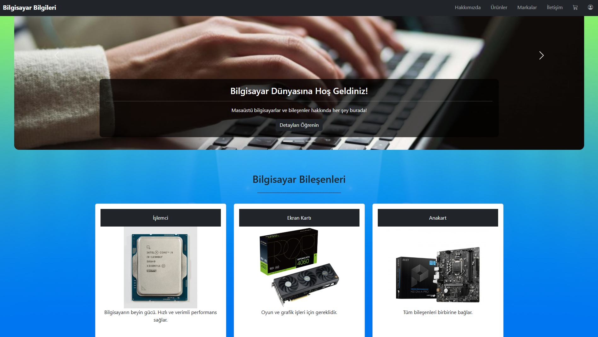
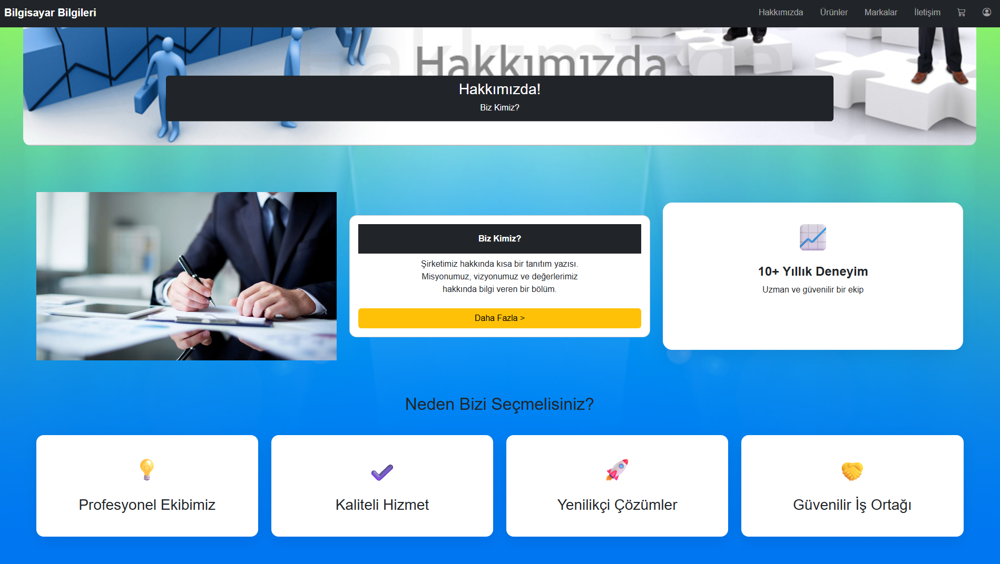
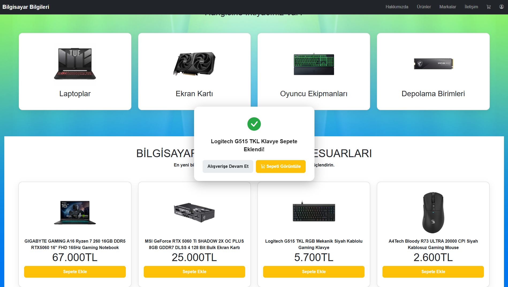
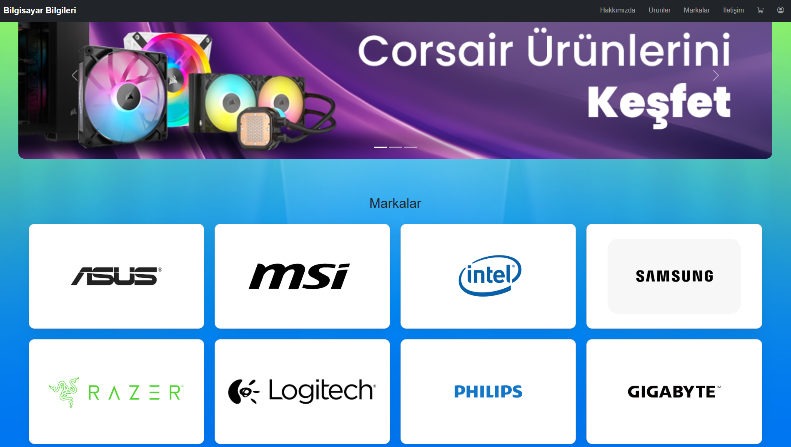
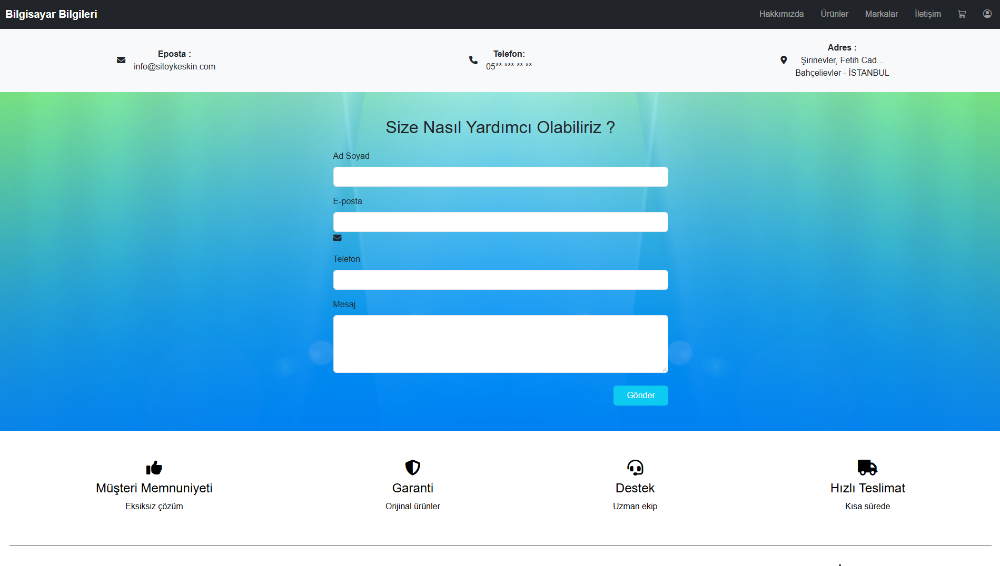
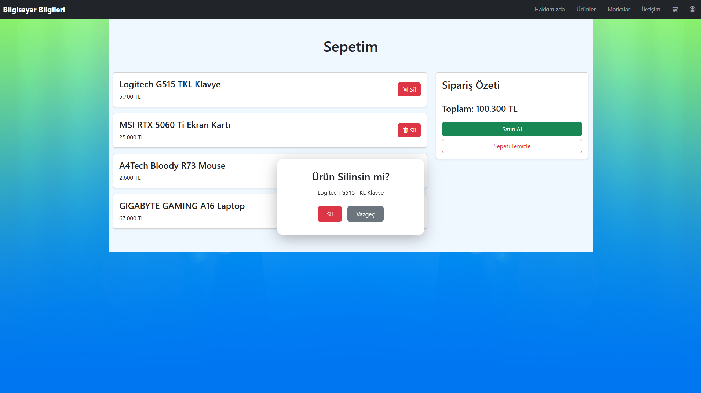
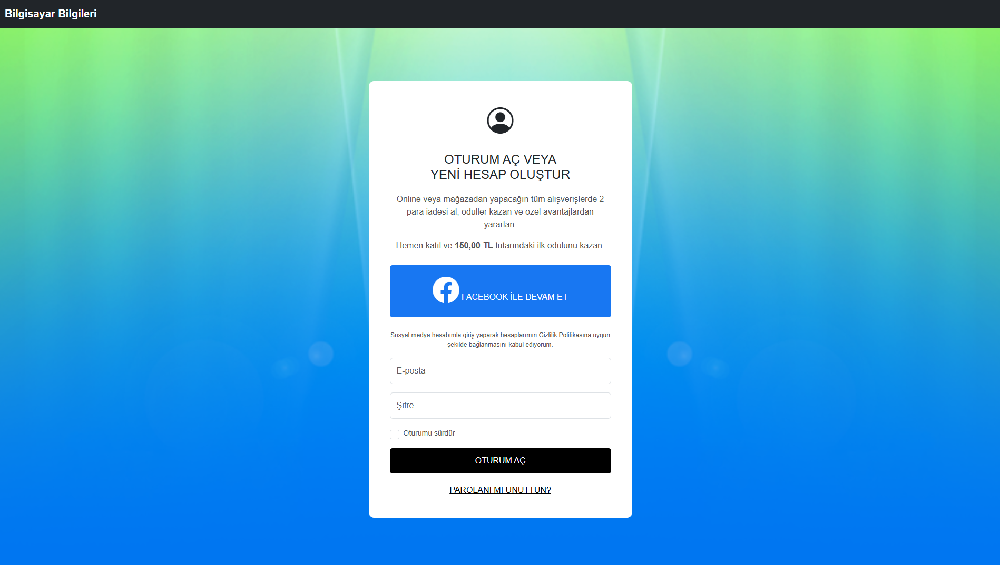
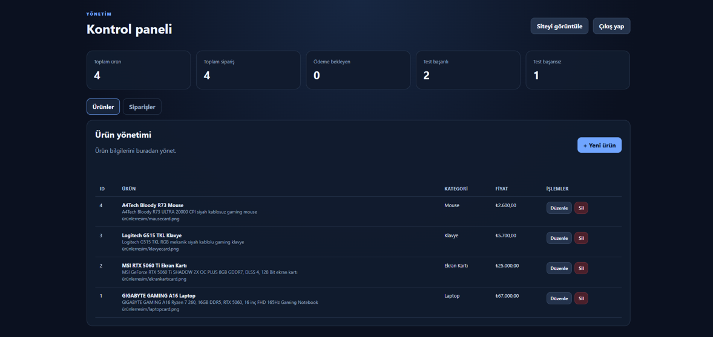

# Bilgisayar Bilgileri

A full-stack computer components e-commerce web application built with HTML, CSS, JavaScript, Node.js, Express, and PostgreSQL.

The project allows users to browse computer hardware products and brands, manage their shopping carts, and complete a test checkout flow. It also includes an administration panel for managing products, stock levels, and customer orders.

> **Note:** The checkout flow is for testing purposes only and does not process real payments. Additional security review and testing are required before production use.

---

## Project Overview

Bilgisayar Bilgileri is an e-commerce web application designed to provide a user-friendly shopping experience for computer components, laptops, and gaming peripherals.

### Main Features

- Product and brand catalog
- Shopping cart management
- Test checkout and order tracking
- Product and stock management
- Customer order management
- Order filtering and status updates
- CSV export for order lists
- PostgreSQL database integration
- Administrative login and management panel

---

## Technologies Used

### Backend

- Node.js
- Express.js
- PostgreSQL
- `pg` (node-postgres)
- `dotenv`
- REST-style API endpoints

### Frontend

- HTML5
- CSS3
- JavaScript
- Fetch API
- Browser Local Storage
- Browser Session Storage

### Security and Data Management

- Server-side product price and stock validation
- Parameterized SQL queries
- Database transactions for order creation and stock updates
- Environment variable configuration
- Administrative session verification
- Order tracking code generation and hash storage

---

## Architecture

The application follows a client-server architecture.

```text
Browser
  |
  v
HTML / CSS / JavaScript
  |
  v
Node.js + Express
  |
  v
PostgreSQL
```

The frontend communicates with the Express server through API endpoints. The server handles application logic and database operations.

---

## Project Structure

```text
Bilgisayar-Bilgileri/
├── OKUL/
│   ├── anasayfa.html
│   ├── hakkimizda.html
│   ├── ürünler.html
│   ├── markalar.html
│   ├── iletişim.html
│   ├── sepet.html
│   ├── satinalma.html
│   ├── hesap.html
│   ├── admin.html
│   ├── siparis-takip.html
│   └── CSS, JavaScript and image files
├── server.js
├── package.json
├── package-lock.json
├── .gitignore
├── STOK_KURULUM.txt
└── README.md
```

- `OKUL/` — Website pages, stylesheets, scripts, and frontend assets.
- `server.js` — Express server and API endpoints.
- `package.json` — Project metadata, dependencies, and scripts.
- `package-lock.json` — Locked dependency versions.
- `.gitignore` — Files and directories excluded from Git.
- `STOK_KURULUM.txt` — Database and installation instructions.

---

## Screenshots

### Home Page


### About Page



### Products Page



### Brands Page



### Contact Page



### Shopping Cart



### User Account Page



### Admin Panel — Product Management



### Admin Panel — Order Management



---

## Getting Started

### Prerequisites

Make sure the following are installed:

- Node.js and npm
- PostgreSQL
- Git

### 1. Clone the Repository

```bash
git clone https://github.com/toygarkeskin/Bilgisayar-Bilgileri.git
cd Bilgisayar-Bilgileri
```

### 2. Install Dependencies

```bash
npm install
```

### 3. Configure Environment Variables

Create a `.env` file in the project root and configure it for your local environment.

```dotenv
PORT=3000
NODE_ENV=development
DB_HOST=127.0.0.1
DB_PORT=5432
DB_NAME=your_database_name
DB_USER=your_database_user
DB_PASSWORD=your_local_database_password
ADMIN_USERNAME=your_admin_username
ADMIN_PASSWORD=your_admin_password
SESSION_SECRET=your_long_random_session_secret
```

Replace the example values with your local configuration. Never commit real passwords, database credentials, or session secrets to the repository.

### 4. Configure the Database

Create and configure the PostgreSQL database and required tables according to the instructions in `STOK_KURULUM.txt`.

### 5. Start the Application

```bash
npm start
```

Open the application in your browser:

```text
http://localhost:3000
```

### 6. Check the Server

To check the JavaScript syntax of the server file, run:

```bash
npm run check
```

This command checks the syntax of `server.js`; it does not test every application feature or guarantee that the database connection is working.

---

## Security Notes

- Keep the `.env` file out of version control.
- Use strong, unique administrative credentials.
- Do not use real customer payment information with the test checkout.
- Review authentication, session handling, HTTPS, error handling, database backups, and stock recovery before any production deployment.
- Test database connectivity and application behavior in your local environment.

---

## Learning Outcomes

This project provided practical experience with:

- Full-stack web application development
- HTML, CSS, and JavaScript
- Node.js and Express
- REST-style API design
- PostgreSQL integration and SQL queries
- CRUD operations
- Shopping cart and checkout workflows
- Product and inventory management
- Order processing and tracking
- Git and GitHub version control

---

## Developer

**Toygar Keskin**

Web Development | Node.js | Express | PostgreSQL

---

## License

No open-source license is specified unless a `LICENSE` file is included in the repository. Reuse and redistribution are therefore subject to applicable rights and permissions.
